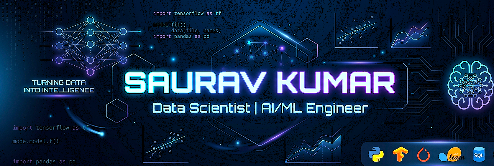

<div align="center">



<a href="https://github.com/saurav526">
  
</a>

[](https://github.com/saurav526)
[](https://github.com/saurav526?tab=followers)
[](https://github.com/saurav526?tab=repositories)

</div>

🚀 **Passionate about Data Science, AI/ML, and Building Real-World Intelligent Systems**

<table>
<tr>

<td width="40%">
  
</td>

<td width="60%">

### 🎓 About Me
- 🎓 B.Tech Computer Science student  
- 🤖 Data Science & AI/ML Enthusiast  
- 🧠 Working on ML & Deep Learning Projects  
- 📊 Love turning data into meaningful insights  
- ⚡ Interested in AI Agents & Automation 
- 🌱 Learning Advanced ML, MLOps & System Design  

</td>

</tr>
</table>
  
### 🛠️ Tech Stack
### 💻 Programming Languages


---

### 📊 GitHub Stats

<div align="center">


</div>

---

### 🐍 Contribution Snake

<div align="center">


</div>

---

### 🔥 Featured Projects

| Project | Stack | Link |
|---|---|---|
| 🛡️ **AI Security Platform** — AI-driven security tooling | Python | [Repo](https://github.com/saurav526/ai-security-platform) |
| 🤖 **Autonomous Cyber Defense** — automated defense system experiment | Python | [Repo](https://github.com/saurav526/autonomous_cyber_defense) |
| 📚 **Production RAG** — retrieval-augmented generation pipeline | Python | [Repo](https://github.com/saurav526/production-rag) |
| 🏫 **Scalable Architecture for Online Learning Platform** — system design for an e-learning platform | Python | [Repo](https://github.com/saurav526/Scalable-Architecture-for-Online-Learning-Platform) |
| 💳 **Credit Card Fraud Detection** — ML model for fraud detection | Python | [Repo](https://github.com/saurav526/credit_card_fraud_detection) |
| 🏥 **Insurance Premium Prediction API** — ML model served via FastAPI | Python | [Repo](https://github.com/saurav526/insurance-premium-prediction-fastapi) |
| 🚗 **Road Lane Detection** — computer vision for lane detection | Python | [Repo](https://github.com/saurav526/Road-Lane-Detection) |
| 🎯 **Customer Segmentation** — clustering-based customer analytics | Python | [Repo](https://github.com/saurav526/Customer_segmention) |
| 🌍 **Carbon Emission Calculator** — web app to estimate carbon footprint | JavaScript | [Repo](https://github.com/saurav526/carbon-emission-calculator) |
| 🚢 **Titanic ML Pipeline** — end-to-end classic ML pipeline | Python | [Repo](https://github.com/saurav526/titanic-ml-pipeline) |
| 🧬 **ML Projects** — collection of machine learning experiments | Jupyter Notebook | [Repo](https://github.com/saurav526/ML-Projects) |
| 🔗 **LangChain Projects** — LLM/agent workflows built with LangChain | Jupyter Notebook | [Repo](https://github.com/saurav526/LANGCHAIN-) |
| ✨ **Gen AI Projects** — generative AI experiments | Jupyter Notebook | [Repo](https://github.com/saurav526/GEN-AI-projects) |

*See all repositories → [github.com/saurav526?tab=repositories](https://github.com/saurav526?tab=repositories)*

---

### 🧭 Currently Exploring

```text
├── Advanced Machine Learning ............ ▓▓▓▓▓▓▓▓░░  80%
├── MLOps & Model Deployment ............. ▓▓▓▓▓░░░░░  50%
├── System Design for ML Platforms ....... ▓▓▓▓░░░░░░  40%
├── AI Agents (LangChain / LangGraph) .... ▓▓▓▓▓▓▓░░░  70%
└── Cybersecurity for AI Systems ......... ▓▓▓▓▓░░░░░  50%
```

---

### 🌐 Connect with Me

<div align="center">

[](https://www.linkedin.com/in/saurav-kumar-a90827323/)
[](https://github.com/saurav526)

</div>

---

<div align="center">

### ✨ Signature

> *"Turning data into intelligence — building systems that learn, adapt, and evolve."*


</div>


